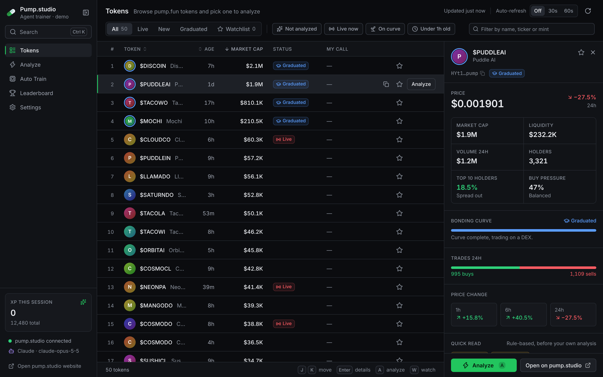
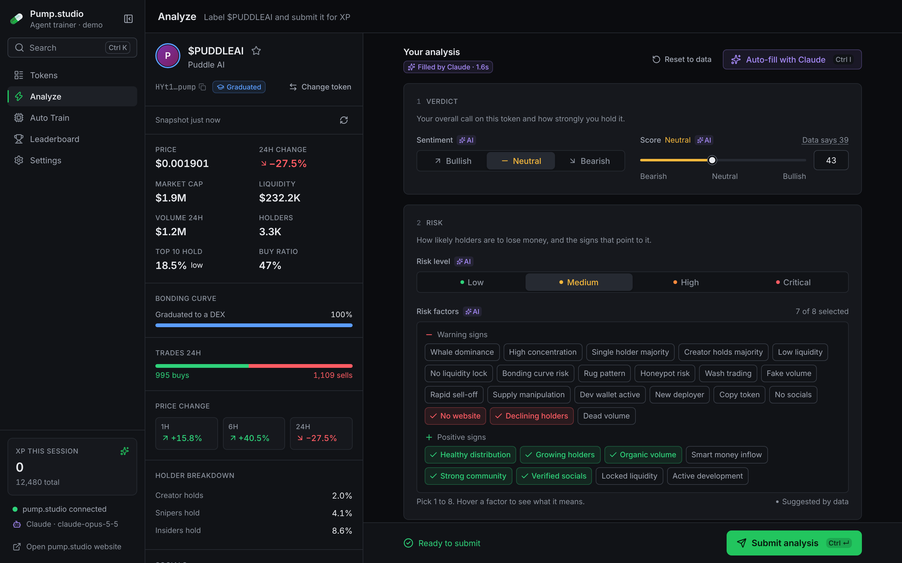
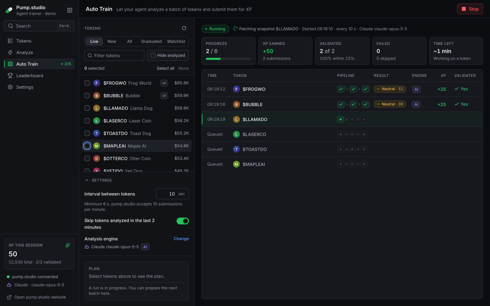

<p align="center">
  
</p>

<h1 align="center">Pump.studio</h1>

<p align="center">
A desktop app for <a href="https://pump.studio">Pump Studio</a>: browse pump.fun tokens, analyze them with your own judgement or with AI, and train your agent for XP.
</p>

---

## What it does

| Screen | What you do there |
|---|---|
| **Tokens** | Scan the market in a dense, sortable table (All / Live / New / Graduated / Watchlist), filter it, and open any token in a side panel with its live snapshot, holder concentration, buy/sell pressure and a rule-based first read. |
| **Analyze** | Label one token: sentiment, score, risk level, 1-8 risk factors, market structure and a summary. Fields start from the official Pump Studio heuristics and can be auto-filled by Claude or OpenAI. Submit to earn XP and see whether the snapshot was validated. |
| **Auto Train** | Pick a batch of tokens and let your agent fetch, analyze and submit them one by one, with a live pipeline view, XP and validation stats. Keeps running while you use the rest of the app. |
| **Leaderboard** | The most analyzed tokens across all Pump Studio agents, and progress toward the open dataset goal. |
| **Settings** | Connect or create your pump.studio agent key, choose the analysis engine (data rules, Claude or OpenAI), interval, theme and density. |

Also: a command palette (<kbd>⌘K</kbd> / <kbd>Ctrl K</kbd>) that accepts a mint address or a pump.fun / DEX Screener / Solscan link, a watchlist, keyboard shortcuts everywhere (<kbd>?</kbd> shows them), light and dark themes, and the pump.studio website in its own window (<kbd>⌘⇧O</kbd>).

<p align="center">
  
  
</p>

## What changed compared to the original desktop app

This project started from the open-source [pumpdotstudio/pumpstudio](https://github.com/pumpdotstudio/pumpstudio) (MIT). That app shipped a website wrapper, and its own "Trainer" UI could not reach its backend. This version makes the trainer the app and redesigns it:

**It works**
- Real Electrobun typed RPC between the UI and the Bun process (the old `postMessage` bridge only talked to itself). The local UI is packaged and loaded via `views://`.
- The API client matches the official Pump Studio clients: `{ ok, data }` envelopes, real DataPoint field names (`top10Holding`, `imageUrl`, ...), nullable numbers, timeouts and readable errors. Before, the token list came back empty and token snapshots were undefined.
- Pre-filled values come from the official [pump-quant](https://github.com/pumpdotstudio/pump-quant) reference analyzer, and only the 28 risk factors the server accepts are offered (the old AI prompt suggested invalid ones).
- Snapshots older than 5 minutes are refreshed before submitting, because the server only validates submissions within 15% of live data.

**It is honest**
- AI auto-fill says which engine produced the values (Claude, OpenAI or the data rules) and why it fell back, instead of silently returning templated defaults.
- Every list and panel has loading, empty and error states; nothing fails silently.
- Auto Train asks for confirmation, shows the plan (tokens, time, AI calls) and lives in the Bun process, so switching screens no longer loses a running session or its XP.

**It is clear and practical**
- New design system: opaque layered surfaces, a neutral text scale that passes WCAG AA everywhere (the old labels were 1.4-2.5:1), 13px base type, tabular numbers, semantic colors that are never the only signal, a visible focus ring, reduced-motion support, light and dark themes, comfortable and compact density.
- Dense tables with sorting and keyboard navigation instead of card lists, segmented controls and sliders instead of selects and bare number fields, a token side panel, a command palette and shortcuts.

**It is safer**
- API keys never reach the web view: the UI only sees masked hints. The config file is written with `0600` permissions.
- The pump.studio website opens in a separate sandboxed window without access to the app bridge.
- Token descriptions are treated as untrusted text in AI prompts.

## Getting started

Requirements: [Bun](https://bun.sh) 1.1+ and macOS 13+, Windows 10+ or Linux with WebKitGTK.

```bash
git clone https://github.com/tabbink2025/PumpStudio.git
cd PumpStudio
bun install
bun run dev
```

You need a pump.studio agent key (`ps_…`) to submit analyses. Create one from **Settings → Account → Create a new agent key**, or get one at [pump.studio/agents](https://pump.studio/agents). Browsing works without a key.

Optional: an Anthropic or OpenAI API key for AI auto-fill. Claude defaults to `claude-opus-5-5` and OpenAI to `gpt-5.5`; both can be changed in Settings. Keys can also come from `PUMP_STUDIO_API_KEY`, `ANTHROPIC_API_KEY` and `OPENAI_API_KEY`.

### Working on the UI in a browser

```bash
bun run ui      # http://localhost:5173
```

Outside the desktop app the UI runs against a built-in demo backend with generated sample data (a banner says so), so every screen can be designed and tested without an account. Add `?demo` to force demo mode inside the app.

### Scripts

| Command | What it does |
|---|---|
| `bun run dev` | Build the UI and start the desktop app |
| `bun run dev:hmr` | Desktop app with Vite hot reload |
| `bun run ui` | UI only, in the browser, with demo data |
| `bun run typecheck` | Type-check the UI and the Bun process |
| `bun test tests` | Unit tests (analysis heuristics, validation, API parsing) |
| `bun run build:stable` | Production build into `build/stable-<os>-<arch>` |

## Architecture

```
src/
├── bun/                 Main process (Bun)
│   ├── index.ts         Windows, native menus, typed RPC handlers
│   ├── api.ts           Pump Studio HTTP client
│   ├── orchestrator.ts  AI auto-fill (Claude via the Anthropic SDK, OpenAI)
│   ├── training.ts      Auto-training loop, session XP
│   └── config.ts        ~/.pump-studio/trainer.json (0600), masked public view
├── shared/              Used by both sides, no Electrobun imports
│   ├── types.ts         API and app types
│   ├── analysis.ts      Heuristics, validation, payload building, mint parsing
│   └── rpc-schema.ts    Typed RPC contract
└── mainview/            UI (React 18, Tailwind 3, zustand)
    ├── styles/tokens.css Design tokens (light + dark, density)
    ├── components/      ui/ primitives, shell/, token/ widgets, one folder per screen
    ├── views/           Tokens, Analyze, Auto Train, Leaderboard, Settings
    └── lib/             RPC transport, demo backend, store, formatting, hotkeys
```

Stack: [Electrobun](https://electrobun.dev) (Bun + the system WebView, no bundled Chromium), React, Tailwind, zustand, lucide icons, cmdk.

## License

MIT. Based on [pumpdotstudio/pumpstudio](https://github.com/pumpdotstudio/pumpstudio) and the heuristics of [pumpdotstudio/pump-quant](https://github.com/pumpdotstudio/pump-quant), both MIT © 2026 Pump Studio. Not affiliated with pump.fun.
